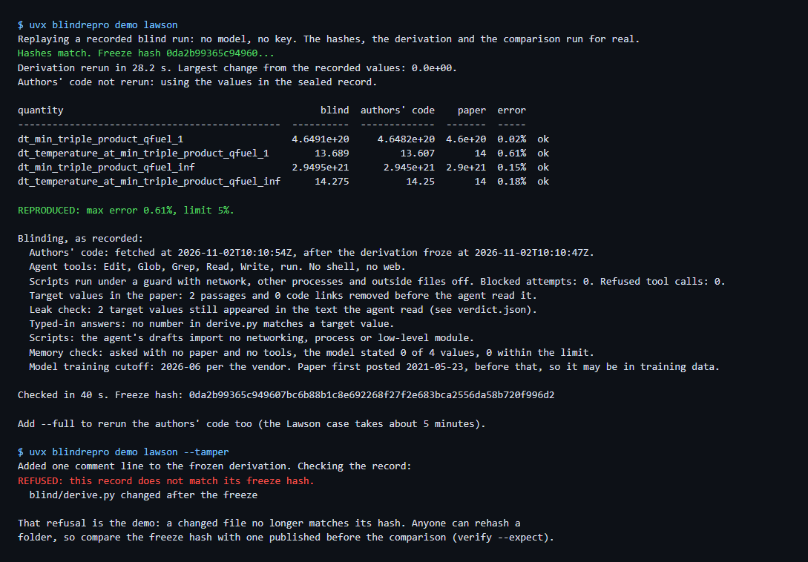

# blindrepro

An agent re-derives a published result from the paper alone, then code compares it with the authors' own code.



A referee asks: does this number follow from what the paper says? blindrepro gives an AI agent the paper with the target values blanked out and no way to reach the authors' code. The agent writes a script. Its files are hashed and frozen. Only then does the tool fetch the authors' code, run it, and compute the error with plain Python. The verdict is a short note you can paste into a referee report.

## Try it: no key, no account

```
uvx blindrepro demo lawson
uvx blindrepro demo lawson --tamper
```

Until the package is on PyPI, clone the repository and use `uvx --from . blindrepro demo lawson`. Needs [uv](https://docs.astral.sh/uv/). From a fresh clone with empty caches, the first demo took 32 to 49 seconds on a Windows laptop (three runs), most of it building the derivation's numpy and scipy environment.

The demo replays a recorded blind run of the Lawson criterion paper. No model is called. It checks every hash against the one published in the package, reruns the frozen derivation, and computes the error again from the authors' values in the sealed record. `--full` reruns the authors' code too, which took 1.5 to 5 more minutes in our runs. `--tamper` adds one line to the frozen derivation and shows the check refusing it.

## What you get

Each run writes `verdict.md`, a note to paste into a referee report, and `verdict.json`. An excerpt of the Lawson note:

```
Result: REPRODUCED: max error 0.61%, limit 5%.
- Authors' code: https://github.com/swurzel/lawson-criterion-paper at 4ae563bfc409db5fb4afb2f9930a3a4fafba4f0d

How the authors' code was called
- Difference from spec (f_c): spec says f_c = 3.5/17.6 = 0.19886. The code uses
  `fraction_charged = 0.2` from `lib/reactions.ini`. I used the code's value.
- Difference from spec (bremsstrahlung): spec says the loss term is C_B T^1/2 with no
  relativistic correction. The Table 3 cell uses the Putvinski relativistic correction.

What was not blinded
- A model may have seen this paper or code during training. The memory check catches
  stated values, not everything a model absorbed.

Record
- Freeze hash (SHA-256): 0da2b99365c949607bc6b88b1c8e692268f27f2e683bca2556da58b720f996d2
- Model: claude-opus-5-5, through claude-cli 2.1.316
```

The listed differences are often the finding. Here the code differs from the paper's equation, as the scoping agent read it, in two places, and the published numbers still hold within 0.61%. The full note also has the values table, the blind agent's stated assumptions, and every check in the image above.

## Run your own

```
blindrepro doctor
blindrepro run arxiv:2105.10954 --target "Table 3, D-T row, magnetic confinement" --code https://github.com/swurzel/lawson-criterion-paper
```

`doctor` says what is missing. The default judge is the official `claude` command, signed in on your own plan; `--judge api` uses `ANTHROPIC_API_KEY` through the official SDK (`pip install "blindrepro[api]"`). blindrepro never reads or stores login tokens. See [docs/judges.md](docs/judges.md).

A run took 4 to 26 minutes per paper in the results below. `--stop-after-freeze` stops at the freeze so you can publish the hash first; `blindrepro verify <folder> --expect <hash>` checks the record later with no model.

## Results on seven published papers

| Paper | Field | Result | Max error | Recalled from memory |
|---|---|---|---|---|
| [2105.10954](https://arxiv.org/abs/2105.10954) Lawson criterion | fusion | REPRODUCED | 0.61% | 0 of 4 |
| [2609.15157](https://arxiv.org/abs/2609.15157) Langevin dynamics in spin glasses | statistical physics | REPRODUCED | 2.2e-12% | 0 of 4 |
| [2609.39121](https://arxiv.org/abs/2609.39121) Metachecks in bivariate bicycle codes | quantum error correction | REPRODUCED | 0 | 5 of 19 |
| [2609.01578](https://arxiv.org/abs/2609.01578) Greedy sampling designs | numerical analysis | REPRODUCED | 4.9e-7% | 0 of 6 |
| [2110.14206](https://arxiv.org/abs/2110.14206) QAOA at high depth | quantum algorithms | REPRODUCED, not blind | 4.5e-6% | 8 of 8 |
| [1809.10246](https://arxiv.org/abs/1809.10246) Optimized stellarator shapes II | fusion | DIVERGED | 18.1% | 3 of 6 |
| [2609.26742](https://arxiv.org/abs/2609.26742) Analytic 3D MHD equilibria | fusion | could not run the authors' code | - | - |

What the failures mean:

- **Stellarator, DIVERGED.** One of six quantities missed. The authors' code reports elongation in the plane normal to the magnetic axis; the paper's table value, 2.52, is in the R-z plane, and the blind value, 2.522, matches it. A referee would want that definition stated.
- **QAOA, not blind.** Asked with no paper and no tools, the model stated all 8 values. The match proves little about the paper; the tool says so in the verdict.
- **MHD, could not run the authors' code.** Their code needs a package with no Windows wheel, and its source build did not finish in two 15-minute tries. The blind result is frozen; nothing was compared.

One run per paper, judge `claude` with model claude-opus-5-5 at effort high, run on 2026-11-02. Error is the largest relative error over the quantities, blind value against the authors' code at the recorded commit. The baseline is the authors' own code; no other tool was run on these papers. Rerun any row with `python evals/run_case.py <name>`, then `python evals/table.py`. Cases, caveats and failures: [evals/README.md](evals/README.md).

## Why not use an agent with the code?

The nearest tools read or regenerate code; none keeps the authors' code out of reach, freezes the result, and then computes an error against that code.

- feynman's `/audit` has an agent read the paper next to the public code; `/replicate` writes a plan. The agent sees the code, so agreement can be copied.
- paper2code and Paper2Code generate code from a paper. They do not run the authors' code or compare numbers.
- PaperBench and CORE-Bench score agents on fixed task sets with rubrics or the authors' environment. They are benchmarks for agents, not a check you point at one paper.
- labrat gives a coding agent research habits; the comparison is the agent's own judgment.

## Limits

- Blinding cannot prove the model never saw the paper or its code in training. Every paper above that was posted before the model's training cutoff (2026-06) may be in its memory. The tool asks the model for the values from memory first and reports what it recalled, which catches only what the model admits.
- The guard on the agent's scripts is a Python audit hook. It blocks the doors a live model found when asked to escape, and it is not a security boundary. Run untrusted authors' code in a container. Details: [docs/blinding.md](docs/blinding.md).
- A match means the paper's method and the authors' code agree. Both can share the same mistake. A mismatch can come from the agent's reading as much as from the paper.
- The scoping step and the adapter that runs the authors' code are written by an agent. Each change to the authors' code is recorded in `authors/patch.diff` and shown in the verdict; read it.
- Results are one run per paper with one model. Another run can differ.
- The `claude` judge sends the paper text to Anthropic under your account's terms. Anthropic's consumer terms limit automated access; read [docs/judges.md](docs/judges.md) before running many papers on a personal plan.

## How it works

```
paper ──► scope ──► blank the target values ──► blind agent writes derive.py
                                                     │
                                       freeze: SHA-256 of every file
                                                     │
authors' code at a commit ──► adapter agent ──► run ──► compare (code, no model)
                                                     │
                                       seal ──► verdict.md and verdict.json
```

The blind agent works in a folder that holds only the redacted paper and the spec. Its only tool besides file editing runs a Python script under the guard; it has no shell and no web. The comparison and the verdict are plain code. `verify` reruns everything from the record. Full list of what is enforced: [docs/blinding.md](docs/blinding.md).

## Credits, license, security

The demo includes code from [swurzel/lawson-criterion-paper](https://github.com/swurzel/lawson-criterion-paper) (MIT), the code for S. E. Wurzel and S. C. Hsu, "Progress toward fusion energy breakeven and gain as measured against the Lawson criterion", [arXiv:2105.10954](https://arxiv.org/abs/2105.10954). Its license is kept next to it. No paper text is bundled.

MIT license. Contributing: [CONTRIBUTING.md](CONTRIBUTING.md). Security: [SECURITY.md](SECURITY.md). blindrepro sends no telemetry.
